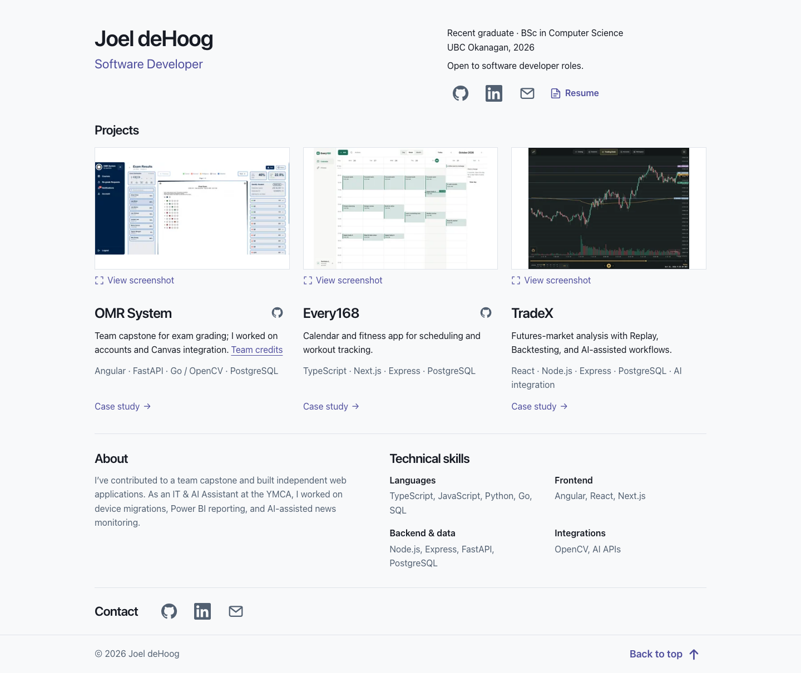

# Joel deHoog — Portfolio

Software Developer and Computer Science graduate from UBC Okanagan. This portfolio
presents my collaborative capstone and independent projects through concise case
studies, genuine application screenshots, and a downloadable resume.

**[Live website](https://portfolio-joels-projects-f04d04ca.vercel.app)**

[GitHub](https://github.com/FrozenOJuice) ·
[LinkedIn](https://www.linkedin.com/in/joel-dehoog-815230293/) ·
[Email](mailto:joel.dehoog@gmail.com) · [Resume](public/Portfolio_Resume.pdf)



The image is an unedited capture of the local production build at a 1440px desktop
viewport. Open it to inspect the full-size homepage.

## Featured projects

| Project | Engineering focus | Source |
| --- | --- | --- |
| OMR System | Exam grading capstone built by a team of six; my contributions included accounts, password recovery, and Canvas integration. | [GitHub](https://github.com/FrozenOJuice/omr-project) · [Contributions](https://github.com/FrozenOJuice/omr-project/blob/main/docs/portfolio/contributions.md) |
| Every168 | Independent calendar and fitness application with scheduling, workout logging, and reliable activity history. | [GitHub](https://github.com/FrozenOJuice/Every168) |
| TradeX | Independent futures-analysis workspace with historical Replay, Backtesting, and AI-assisted analysis. | Private |

Each project has an internal case study covering my role, architecture, engineering
decisions, testing, and limitations. Screenshots open in a separate viewer. The
resume opens in an overlay with zoom, download, and close controls.

## Technology

Astro 7, strict TypeScript, Tailwind CSS 4 through the official Vite plugin, and the
official Astro MDX integration. npm manages dependencies. All four pages are
statically generated; client-side JavaScript supports the viewers and tooltips.
The portfolio has no backend, database, React integration, or UI library.

## Local development

Use Node.js **24.x**, as specified in `.nvmrc` and `package.json`, and npm.

```sh
nvm install
nvm use
npm ci
npm run dev
```

Open the local URL printed by Astro, normally `http://localhost:4321`.
No environment variables or external services are required.

| Command | Purpose |
| --- | --- |
| `npm run dev` | Start the development server. |
| `npm run check` | Check resume-preview consistency, Astro, and TypeScript. |
| `npm run build` | Run checks and generate the production site in `dist/`. |
| `npm run preview` | Serve the production build locally. |
| `npm run resume:preview` | Regenerate resume previews on macOS after replacing the PDF. |

Use `npm install` when changing dependencies and keep `package-lock.json` in sync.

## Maintaining content

| Location | Content |
| --- | --- |
| `src/pages/index.astro` | Homepage and About copy. |
| `src/data/site.ts` | Profile links, skills, and resume path. |
| `src/data/projects.ts` | Project summaries, images, and public source links. |
| `src/content/projects/*.mdx` | Case-study writing. |
| `src/layouts/CaseStudyLayout.astro` | Shared case-study layout and section navigation. |
| `src/styles/global.css` | Theme, responsive layout, and interaction styles. |
| `src/assets/projects/README.md` | Screenshot provenance and retained notices. |
| `src/assets/social-card.svg` / `public/social-card.png` | Editable social card and its PNG export. |

Case studies are generated at `/projects/omr-system/`, `/projects/every168/`, and
`/projects/tradex/`. Their `projectId` frontmatter matches `src/data/projects.ts`.
Project titles open these pages; screenshot links open the image viewer.

To update the resume:

1. Replace `public/Portfolio_Resume.pdf`.
2. Run `npm run resume:preview` on macOS, using the built-in PDFKit renderer.
3. Run `npm run build` and review the overlay.
4. Include the PDF, `src/assets/resume/`, and `src/data/resume-preview.json` together
   when committing the update. The consistency check rejects stale previews.

Production builds use the generated assets and do not need macOS or Swift.
Set `site.resume` to `null` to hide the resume link.

## Verification

Run `npm run check` and `npm run build`, then review `npm run preview` at 1440, 768,
390, and 320px widths. Check all four pages, project-title and section links,
image loading, keyboard navigation, social tooltips, and both viewers. Confirm PDF
download and that closing either viewer restores focus and the page position.
Viewers support Close, Escape, and outside clicks; reduced-motion preferences are
respected. Without JavaScript, image and resume links still open their source files.

To refresh the README image, capture the finished production homepage at 1440px
wide with overlays closed and save it to `docs/screenshots/homepage-desktop.png`.

## Vercel configuration

| Setting | Value |
| --- | --- |
| Framework preset | Astro |
| Root directory | Repository root |
| Install command | `npm ci` |
| Build command | `npm run build` |
| Output directory | `dist` |
| Node.js | 24.x |

The Node engine is pinned to match `.nvmrc` and avoid Vercel selecting a different
major. Static output needs no server adapter or additional Vercel configuration.
See [Astro's Vercel guide](https://docs.astro.build/en/guides/deploy/vercel/) and
[Vercel's Node version rules](https://vercel.com/docs/functions/runtimes/node-js/node-js-versions).

Astro's `site` property in `astro.config.mjs` uses the live website origin above
to generate canonical URLs and absolute social-image URLs. Update it if the
production domain changes.
